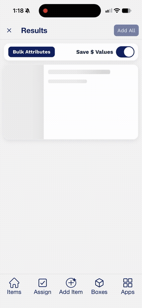
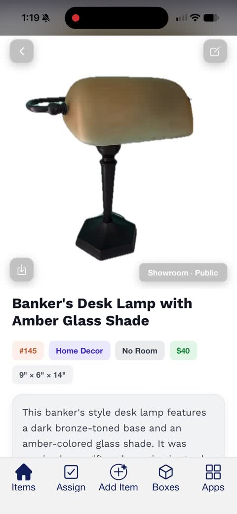
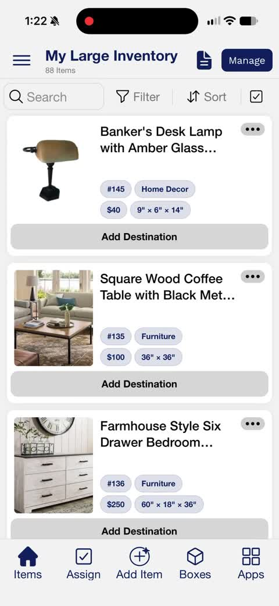
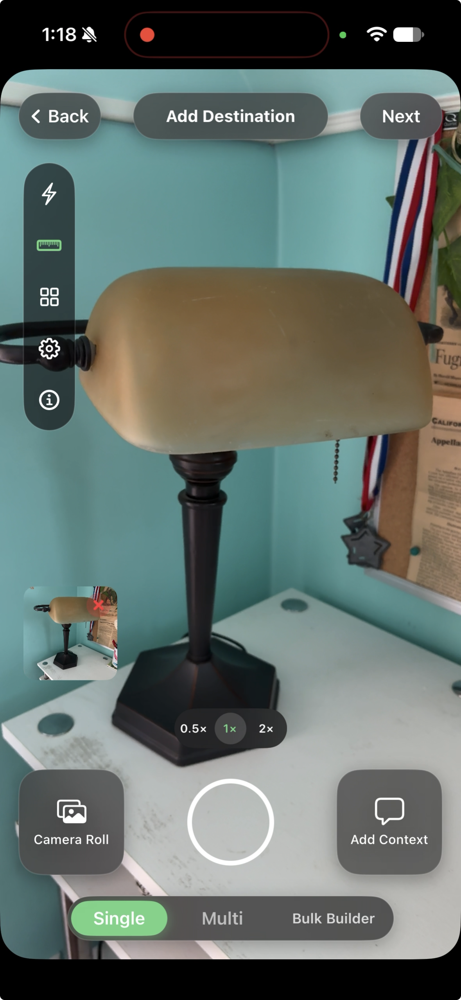
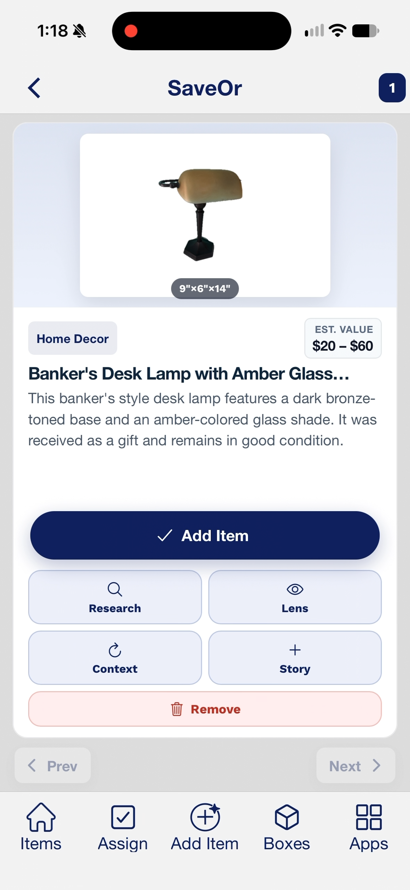
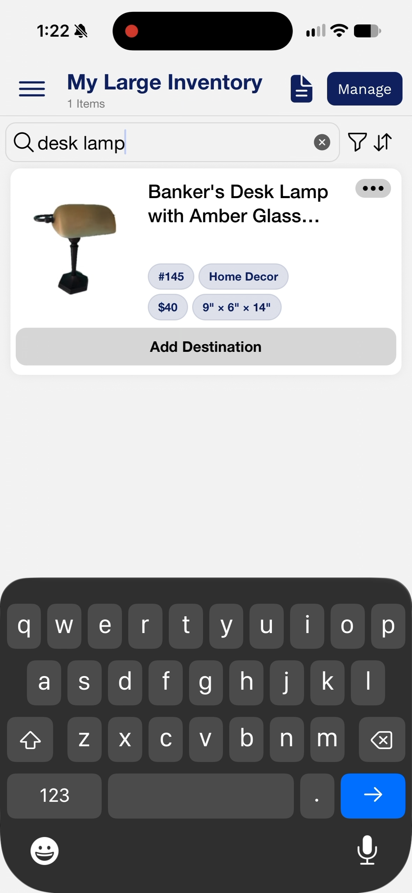
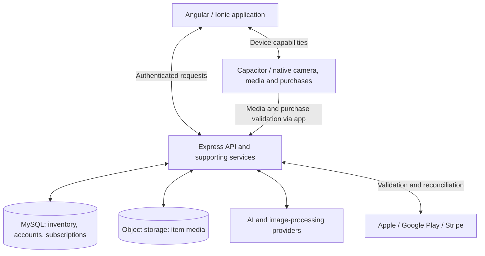

# SaveOr — product & engineering case study

**From a photographed object to an organized inventory.** SaveOr brings item capture, AI-assisted descriptions, media, and inventory management into a web and mobile workflow.

I am SaveOr’s **CTO, product creator, and current sole maintainer**. I own product engineering and ship every release, and have done so for the past two years.

| Product scale | As of November 2026 |
| --- | ---: |
| Users | 1,500+ |
| Business partners | 72 |
| Paying subscribers | More than 500 |

Figures are reported by the maintainer; they are product totals, not benchmark sample sizes.

## Watch the workflows

Two mobile recordings follow a desk lamp from capture to a saved item, then demonstrate search, sorting, and filtering in the inventory.

*Short preview from the item-creation recording. The full recordings below preserve the supplied timing and have no audio.*

| Item creation · 49 seconds | Inventory browsing · 25 seconds |
| --- | --- |
|  |  |
| Capture, background removal, context, AI results, saving, and the product page. | Search for the desk lamp and explore inventory sorting and filtering. |

[Watch item creation](assets/demo/saveor-product-demo.mp4) · [Watch inventory search, sort, and filter](assets/demo/saveor-inventory-demo.mp4)

I maintain and extend the surrounding context, review, and inventory workflow. **David Koffi built the initial Gemini/camera implementation.**

## Selected workflows

### Capture and context

I maintain and extend the surrounding context, review, and inventory workflow. Initial Gemini/camera implementation: David Koffi. This capture shows the camera and Add Context entry point; the recording shows entering context and the background-removed result.

### AI results and saving

My ongoing product work integrates AI-assisted item review and saving into the inventory experience. The lamp’s description incorporates the supplied gift context.

### Inventory search

I redesigned inventory loading around a complete searchable index with incremental detail loading and bounded card rendering. This screenshot demonstrates search behavior; the engineering case study explains the implementation and verification.

## Engineering decisions

- **[Inventory loading at scale](docs/inventory-loading.md):** Keep search complete while loading expensive item details only when an action needs them. Bound rendering, requests, and retained details independently.
- **[Payment and entitlement reliability](docs/payment-reliability.md):** Translate native purchases and Stripe into consistent access decisions, reconcile stale provider state, and distinguish a network outage from revoked access.
- **[AI-assisted item creation](docs/ai-item-creation.md):** Carry contextual inputs through capture, review, retry, and save.

## Architecture

This is a high-level responsibility map, not a deployment or network diagram. See [architecture notes](docs/architecture.md) for the important boundaries.

## Ownership and credit

My current scope spans the application, backend integrations, maintenance, and release delivery. This case study focuses on inventory performance, subscription reliability, and the surrounding AI item-creation workflow.

**David Koffi built the initial Gemini/camera implementation.** My product ownership and subsequent maintenance do not imply sole authorship of that initial implementation. See the [ownership summary](docs/ownership.md).

## About this repository

This repository contains engineering explanations, product recordings, and screenshots supplied by the maintainer. It contains no SaveOr application source code or standalone recreation of its implementation.

Implementation descriptions are based on a review of the private application and API. Existing test coverage is described explicitly; no new application test run or production benchmark is claimed by this documentation work. Release-specific outcomes and account repair counts are included only when supported by evidence.

[Publishing guide](docs/publishing.md) · [Media capture guide](docs/capture-guide.md)
