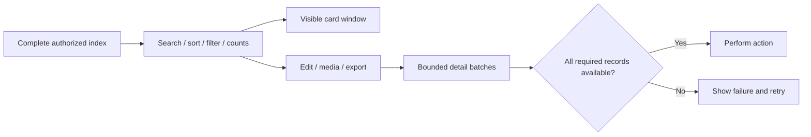

# Inventory loading at scale

## Problem

An inventory list does not need every description, document, comment, and secondary image before showing usable cards. Loading complete records couples browsing to the most expensive data in the inventory. It also makes exports and list rendering compete for memory. On the API side, combining several one-to-many relationships in one join can multiply rows before the response is assembled.

Simply paginating full records would reduce initial work, but searching only loaded pages would silently miss items. The design needed to keep whole-inventory search, sorting, filtering, counts, and selection correct.

## Decision

Separate the complete **authorized inventory index** from full item details. The index carries the fields used by cards and list operations, plus a deterministic cover image. Search and selection run over that complete index, regardless of scroll position.

An edit, media action, or export resolves the complete records it needs. Detail requests are batched and deduplicated. Missing or failed detail responses stop the action and expose a retry path rather than passing an incomplete record onward.

The implementation limits detail batches to 50 IDs, runs up to two detail requests at once, and retains at most 250 complete records in shared inventory state. An explicit full-inventory export obtains its own complete result. These are implementation limits, not measured production performance claims.

## Rendering and stale data

The grid mounts a window of cards within the existing Ionic scroll container. Measured row heights accommodate variable content; spacer estimates represent unvisited rows. Stable item IDs preserve unchanged views, and scroll anchoring prevents measurements above the viewport from moving the visible item unexpectedly.

The initial index fetch has a loading state; thumbnails reserve space while decoding; slower detail actions show an inline loader. Image resolving has its own concurrency and cache bounds.

Session metadata is persisted separately from inventory data. A browser reload fetches an authoritative index. Session, inventory, and refresh generations prevent older responses from publishing into a newer context. Refresh preserves local creates, edits, and deletes made while the request is in flight. A failed refresh keeps the current list available.

On the server, separate batched collection queries avoid multiplying images, comments, and interests through a single large join. Authorization and item visibility apply to both index and detail requests.

## Tradeoffs

- The complete index still grows with inventory size. This approach is not constant-memory browsing for arbitrarily large inventories.
- Search covers the fields included in the index; it is not a full-text search over omitted descriptions and documents.
- Full exports still require full data and can temporarily consume additional memory.
- Measured virtualization and response-generation checks add complexity, but keep rendering cost bounded and prevent stale updates.
- The new API must be available before the corresponding client is released. Additive endpoints preserve compatibility with older clients.

## Verification

Existing focused tests cover whole-index search/sort/filter, request and cache limits, race conditions, failed detail batches, and complete records at edit/media/export boundaries. Rendering tests exercise multiple viewport widths, variable card heights, large scroll jumps, and bounded mounted views. API integration tests cover authorization, item visibility, deterministic covers, query bounds, and migration reversibility.

The private engineering notes describe synthetic test scenarios of up to 10,000 items for list operations and 2,500 items for API integration. These are test sizes, not customer inventory measurements. Image responses in rendering tests are mocked. This case study does not claim a new test run, a production speedup percentage, or completed device/staging validation.

## What the demo can prove

Record browsing, filtering, and opening an item in a synthetic inventory. The visible result demonstrates the interaction; it does not prove network latency or memory improvements. A defensible performance comparison would additionally record the same dataset, device, network conditions, initial-load timing, request counts, and retained memory before and after the change.
